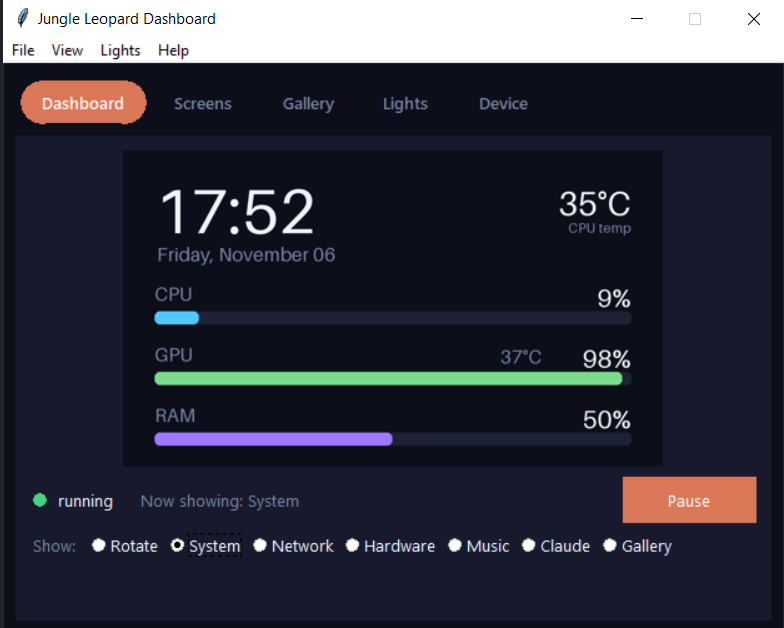

# Jungle Leopard PF360

A small Windows app that drives the LCD and fan lights of a Jungle Leopard (TZMRIT-style)
AIO cooler, replacing the vendor's Electron app.

- **LCD screens:** system, network, hardware, now playing, Claude Code usage, and a gallery of
  your own pictures, GIFs and videos
- **Fan lights:** Claude palette (dark and light), static, breathing, rainbow, colour cycle - via OpenRGB
- **GUI:** live preview, screen order, gallery, lights and device settings

Tested with a `33C3:7792` panel (1024x600, firmware 3.6) on Windows 10, with the fans on a
Gigabyte motherboard's `D_LED2` header.

## Run

```
pip install -r requirements.txt
pythonw gui.pyw
```

Close the vendor's *Jungle Leopard Display* app first - only one program can use the cooler's
serial port. The Lights tab can install OpenRGB for you; the Device tab can install
LibreHardwareMonitor (admin prompt) for CPU temperature and fan RPM. Both are optional and
downloaded on demand, not bundled.

## How it works

The cooler is a USB serial device (VID `0x33C3`). Commands are `55 AA | len | cmd | payload |
checksum` frames; images are `len | JPEG | checksum`. See `jl.py` for the details. The Claude
screen reads local Claude Code logs only - nothing is sent anywhere.

## Credits

Protocol cross-checked against
[senesees/Jungle-Leopard-Display-TZMRIT-PF360-LCD](https://github.com/senesees/Jungle-Leopard-Display-TZMRIT-PF360-LCD).
OpenRGB and LibreHardwareMonitor are separate projects with their own licences.
